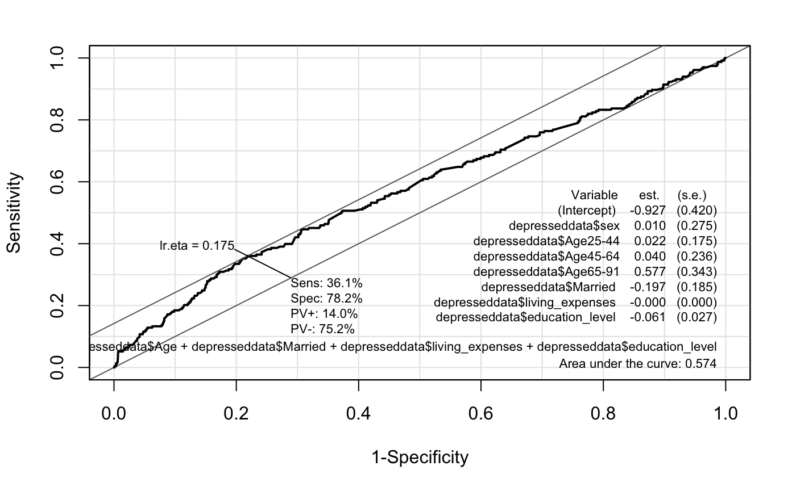
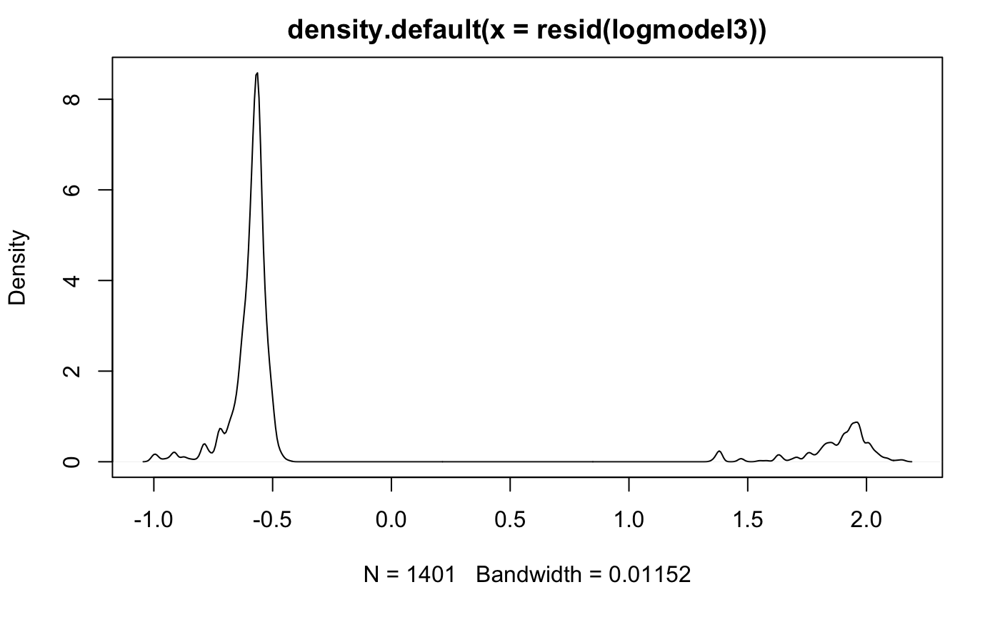
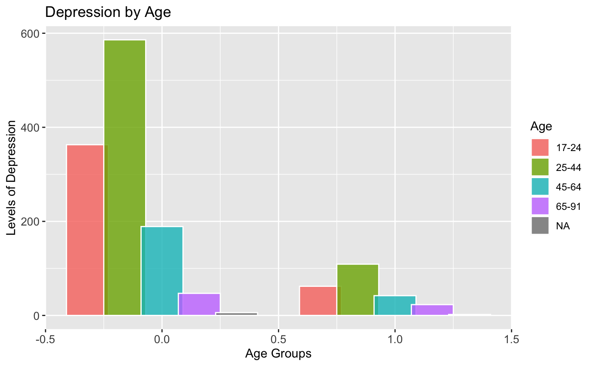
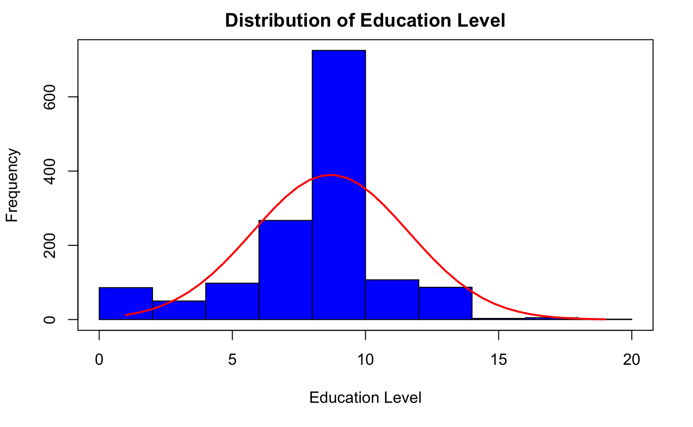
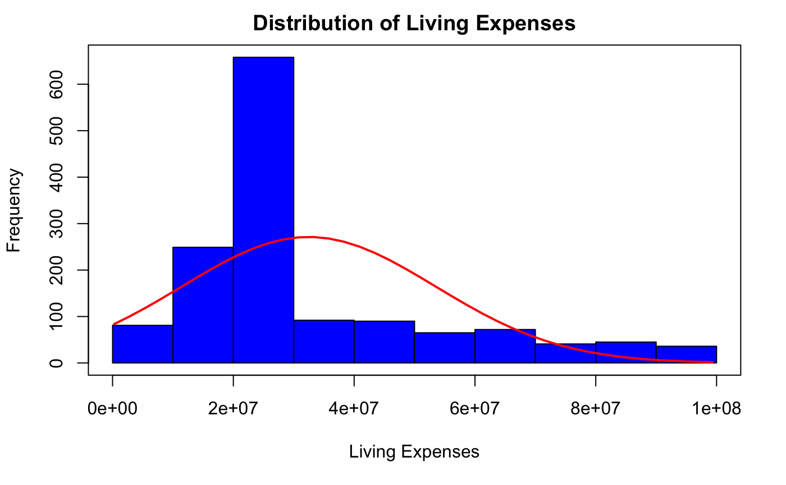

# Predicting the Probability of Depression — Logistic Regression

Three sequential logistic regression models predict the probability of
depression from sex, age, marital status, education level and living
expenses, on survey data from 1,401 people living in rural parts of an
unnamed country. The honest result: the predictors barely explain
depression at all.

## Summary

**Research question:** Can the probability of depression be predicted from
sex, age, marital status, education level and living expenses — and which
of those factors actually matter?

**What is built:** three sequential logistic regression models in R — sex
alone, then age and marital status added, then education level and living
expenses added — with hypothesis tests (chi-square, Mann–Whitney U,
Shapiro–Wilk), odds ratios, variance-inflation checks and ROC curves,
evaluated against the majority-class baseline.

**How it helps:** it shows which demographic factors do and don't predict
depression in this sample, and it shows the evaluation discipline that
matters: a baseline, an ROC curve, and weak results reported as weak
rather than dressed up.

## Data

The data is the public `b_depressed` dataset from Kaggle
([diegobabativa/depression](https://www.kaggle.com/diegobabativa/depression)):
survey results from people living in rural parts of a country, on their
life conditions. The file has 1,429 rows and 23 columns; six are used
here:

| Column | Meaning |
|---|---|
| `depressed` | 0 = depressed, 1 = not depressed |
| `sex` | 0 = male, 1 = female |
| `Age` | Years (17–91), grouped into 17–24, 25–44, 45–64, 65–91 |
| `Married` | 0 = not married, 1 = married |
| `education_level` | Years of education (1–19; mean 8.70, SD 2.92, median 9) |
| `living_expenses` | Annual spending on food, housing, clothes, transport, in dollars (mean $32,519,698, SD $21,068,111, median $26,692,283) |

The other 17 columns (number of children, assets, income sources, farm
expenses and the like) are in the file and unused. Cleaning: 20 records
are dropped for a missing value, and the age cut drops the eight
17-year-olds (the cut starts above 17), leaving 1,401 rows for analysis.

## Method

Three sequential logistic regression models (`glm`, binomial family),
each adding a block of predictors, following Peng, Lee & Ingersoll (2002):
overall model evaluation, tests of individual predictors, goodness-of-fit
and an assessment of the predicted probabilities. The outcome coding
(0 = depressed, 1 = not depressed) means coefficients describe the odds
of *not* being depressed; odds ratios for depression are the reciprocal.

Variance-inflation factors for Model 3 are all below 1.5, so
collinearity is not a concern. Model fit improves from Model 1 to Model 3
(deviance 1,270.2 → 1,247.4 → 1,241.7; AIC 1,274.2 → 1,259.4 →
1,257.7), but from a starting point so weak that the improvement is
small in absolute terms.

No train/test split was used: the aim here is inference about which
factors predict depression, not out-of-sample forecasting, and with only
233 not-depressed cases a split would leave too little signal to split.
That is a limitation to keep in mind — the AUCs above are in-sample.

## Results

Coefficients are on the not-depressed scale — a positive coefficient
means higher odds of not being depressed (see Method).

83.4% of the sample is depressed (1,168 of 1,401), so the baseline is
steep: predicting "depressed" for everyone already gets 83.4% accuracy.
None of the three models beats that.

| Model | Predictors | LR χ² (df) | p | Nagelkerke R² | AUC | Accuracy |
|---|---|---|---|---|---|---|
| 1 | Sex | 0.05 (1) | 0.831 | 0.0001 | 0.502 | 0.833 |
| 2 | Sex + age + married | 13.45 (5) | 0.020 | 0.016 | 0.550 | 0.834 |
| 3 | + education + living expenses | 19.18 (7) | 0.008 | 0.023 | 0.574 | 0.834 |
| Baseline | Always predict depressed | — | — | — | 0.500 | 0.834 |

Model 3 in full (n = 1,401):

| Variable | β | SE | z | p |
|---|---|---|---|---|
| Intercept | −0.927 | 0.420 | −2.210 | 0.027 |
| Sex (female) | 0.010 | 0.275 | 0.038 | 0.970 |
| Age 25–44 | 0.022 | 0.175 | 0.124 | 0.901 |
| Age 45–64 | 0.040 | 0.236 | 0.170 | 0.864 |
| Age 65–91 | 0.577 | 0.343 | 1.683 | 0.092 |
| Married | −0.197 | 0.185 | −1.064 | 0.288 |
| Education level | −0.061 | 0.027 | −2.278 | 0.023 |
| Living expenses | −0.000 | 0.000 | −0.740 | 0.459 |

The ROC curve for Model 3 has area under the curve 0.574 — barely above
chance. At the best threshold the model catches 36.1% of the
not-depressed (sensitivity) at 78.2% specificity; the positive predictive
value is only 14.0%, because not-depressed is rare in this sample (16.6%).

The density of Model 3's residuals is bimodal, as expected for a binary
outcome — the two peaks are the two outcome groups, not a modelling
problem.

## Data exploration

Depression by age group — the not-depressed share rises with age:

| Age group | n | Depressed | Odds of not being depressed |
|---|---|---|---|
| 17–24 | 414 | 85.0% | 0.176 |
| 25–44 | 692 | 84.4% | 0.185 |
| 45–64 | 230 | 81.7% | 0.223 |
| 65–91 | 65 | 67.7% | 0.477 |

Chi-square tests for independence (Yates' correction):

| Variable | χ² | df | p | phi |
|---|---|---|---|---|
| Sex | 0.010 | 1 | 0.922 | 0.003 |
| Married | 5.437 | 1 | 0.020 | 0.062 |
| Age group | 13.303 | 3 | 0.004 | 0.097 |

Mann–Whitney U tests (depressed vs not depressed):

| Variable | U | p | Median (dep. / not dep.) | Mean (dep. / not dep.) |
|---|---|---|---|---|
| Education level | 153,770 | 0.001 | 9 / 9 | 8.83 / 8.06 |
| Living expenses | 145,083 | 0.102 | $26,692,283 / $26,692,283 | $32,744,494 / $31,392,823 |

Neither continuous variable is normally distributed. Education level is
left-skewed (skew −0.77, z = −11.8; kurtosis 1.45, z = 11.1; Shapiro–Wilk
W = 0.896, p < 0.001) and living expenses right-skewed (skew 1.23,
z = 18.8; kurtosis 1.05, z = 8.1; Shapiro–Wilk W = 0.856, p < 0.001).
That is why the group comparisons use Mann–Whitney U rather than t-tests,
and why logistic regression — which needs no normality assumption for the
predictors — is the right model. A correlation matrix over all 23 columns
of the raw file is also in the assets folder.

## Conclusion

- **The models barely predict.** Nagelkerke R² runs 0.01% to 2.3% across
  the three models, AUC 0.50 to 0.57, and accuracy never rises above the
  83.4% baseline. A model that predicts "depressed" for everyone matches
  the best fitted model on accuracy.
- **Sex is not a significant predictor** — in Model 1 (p = 0.831), Model 2
  (p = 0.613) or Model 3 (p = 0.970). The literature expects women to be
  about twice as likely to be depressed; this sample finds no difference.
  One caveat: the sample is 91.8% female, so the comparison rests on
  only 115 men.
- **The oldest group is less likely to be depressed, not more.** In
  Model 2, age 65–91 is the only significant age group (β = 0.851,
  p = 0.008): its odds of *not* being depressed are 2.34 times the
  17–24 group's. The raw rates tell the same story — 67.7% depressed at
  65–91 against 85.0% at 17–24. The effect fades once education is added
  (Model 3, p = 0.092).
- **Education is the only significant predictor in Model 3** (β = −0.061,
  p = 0.023): each additional year of education multiplies the odds of
  depression by about 1.06. In this sample, more education goes with
  *more* depression, not less — against the protective effect the
  literature reports. The medians are identical (9 years in both groups);
  the difference is in the means (8.83 depressed vs 8.06 not depressed).
- **Living expenses do not predict depression** (p = 0.459). The medians
  are identical ($26,692,283 in both groups) and the distributions
  overlap almost entirely.
- **Marital status is associated in a simple test but not in the models.**
  The chi-square is significant (p = 0.020, phi = 0.062) yet married is
  not significant in Model 2 (p = 0.147) or Model 3 (p = 0.288).

Demographics alone explain very little of who reports depression in this
sample. That is the finding — and it is why the models are reported as
weak rather than dressed up.

## Reproduce

R 4.0.2. Install the packages listed at the top of the Rmd
(tidyverse, ggalt, gridExtra, broom, ggpubr, dplyr, car, psych, Hmisc,
ggplot2, gmodels, DescTools, stargazer, semTools, corrplot, Epi, lmtest,
rcompanion), then knit `analysis/depressed-dataset.Rmd`. It reads
`../data/b_depressed.csv` and reproduces the tables and figures in this
README. The numbers in this README were verified by re-running the
models independently in Python (statsmodels) on the same cleaned data.

## References

- Akhtar-Danesh, N., & Landeen, J. (2007). Relation between depression
  and sociodemographic factors. *International Journal of Mental Health
  Systems*, 1(1), 4.
- Angst, J., Gamma, A., Gastpar, M., Lépine, J. P., Mendlewicz, J., &
  Tylee, A. (2002). Gender differences in depression. *European
  Archives of Psychiatry and Clinical Neuroscience*, 252(5), 201–209.
- Bjelland, I., Krokstad, S., Mykletun, A., Dahl, A. A., Tell, G. S., &
  Tambs, K. (2008). Does a higher educational level protect against
  anxiety and depression? The HUNT study. *Social Science & Medicine*,
  66(6), 1334–1345.
- Fakhari, A., Farahbakhsh, M., Azizi, H., Esmaeili, E. D., Mirzapour, M.,
  Rahimi, V. A., & Gaffarifam, S. (2020). Early marriage and negative
  life events affect on depression in young adults and adolescents.
  *Archives of Iranian Medicine*, 23(2), 90–98.
- Frech, A., & Williams, K. (2007). Depression and the psychological
  benefits of entering marriage. *Journal of Health and Social Behavior*,
  48(2), 149–163.
- Goodwin, R. D., & Gotlib, I. H. (2004). Gender differences in
  depression: the role of personality factors. *Psychiatry Research*,
  126(2), 135–142.
- Haan, M. (2009). Roger Tarling, *Statistical Modelling for Social
  Researchers: Principles and Practices*. *Canadian Journal of
  Sociology*, 34(1), 271–274.
- Nolen-Hoeksema, S. (2002). Gender differences in depression. In I. H.
  Gotlib & C. L. Hammen (Eds.), *Handbook of Depression* (pp. 492–509).
  Guilford Press.
- Peng, C. Y. J., Lee, K. L., & Ingersoll, G. M. (2002). An introduction
  to logistic regression analysis and reporting. *The Journal of
  Educational Research*, 96(1), 3–14.
- Piccinelli, M., & Wilkinson, G. (2000). Gender differences in
  depression: Critical review. *The British Journal of Psychiatry*,
  177(6), 486–492.
- Stoltzfus, J. C. (2011). Logistic regression: a brief primer.
  *Academic Emergency Medicine*, 18(10), 1099–1104.
- van't Veer-Tazelaar, P. J. N., van Marwijk, H. W., Jansen, A. P. D.,
  Rijmen, F., Kostense, P. J., van Oppen, P., & Beekman, A. T. (2008).
  Depression in old age (75+), the PIKO study. *Journal of Affective
  Disorders*, 106(3), 295–299.

## A note on the topic

Depression is a clinical condition, and this analysis is a statistical
exercise on aggregate survey data — it says which demographic factors
are and aren't associated with depression in one sample. It is not a
diagnostic tool, and it says nothing about any individual.

## Notes on this file

The analysis code is `analysis/depressed-dataset.Rmd`. Cleaning was
limited to the file's framing and reproducibility: the header is a project
header rather than a submission cover sheet, the data path points at
`../data/b_depressed.csv`, and two unused package imports were removed.
Three substantive corrections were made, all documented here so the code
and this README agree:

- **Model 1 was fitted with `lm()`, not `glm()`.** `lm()` ignores the
  `family` argument, so the first model was in fact a linear probability
  model (ordinary least squares on a binary outcome), not a logistic
  regression. It has been corrected to `glm(..., family = binomial())`,
  and the Model 1 numbers in this README are the logistic fit.
- **The inline pasted output in the code was from a run on the uncleaned
  data** (1,421 rows — before the 20 incomplete records were dropped).
  It has been updated to the run on the cleaned data (1,401 rows), which
  is what this README reports. The ROC figure already matched the
  cleaned-data run.
- **The not-depressed living-expenses histogram plotted the depressed
  group's mean and standard deviation** for its normal curve (a
  copy-paste slip). It now uses the not-depressed group's own statistics.

Stray non-code lines were also removed: a leftover `cor(glass)` call and
three unexplained "Factor %" figures in the pasted output.

## Licence

MIT — see `LICENSE`.
